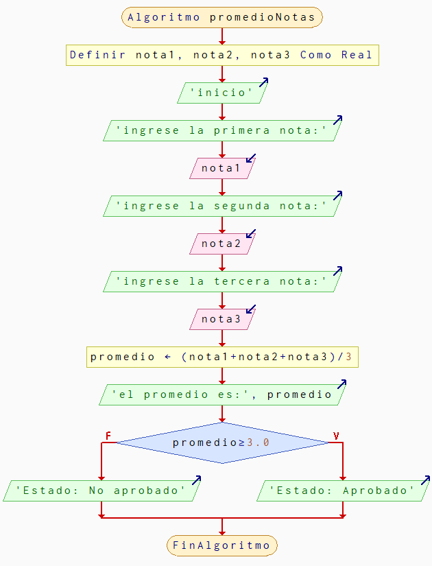

# Ejercicio 01: Cálculo de Promedio

**Nivel:** Básico

## Enunciado
Cálculo de Promedio: Leer tres notas de un estudiante y calcular su promedio. Mostrar el resultado en pantalla.

## Pseudocódigo


Algoritmo promedioNotas

```text
	Definir nota1, nota2, nota3 Como Real

	Escribir 'inicio'

	Escribir 'ingrese la primera nota:'

	Leer nota1
	Escribir 'ingrese la segunda nota:'
	Leer nota2
	Escribir 'ingrese la tercera nota:'
	Leer nota3
	promedio <- (nota1+nota2+nota3)/3
	Escribir 'el promedio es:', promedio
	Si promedio>=3.0 Entonces
		Escribir 'Estado: Aprobado'
	SiNo
		Escribir 'Estado: No aprobado'
	FinSi

FinAlgoritmo
```


## Diagrama de Flujo



---
[⬅ Volver al README](../../README.md)
