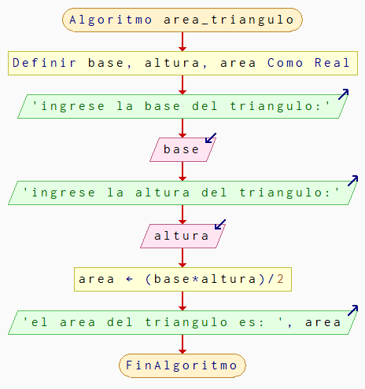

# Ejercicio 02: Área de un Rectángulo

**Nivel:** Básico

## Enunciado
Área de un Rectángulo: Leer la base y la altura de un rectángulo, calcular y mostrar su área y su perímetro.


## Pseudocódigo

```text 
Algoritmo area_triangulo
	Definir base, altura, area Como Real
	Escribir 'ingrese la base del triangulo:'
	Leer base
	Escribir 'ingrese la altura del triangulo:'
	Leer altura
	area <- (base*altura)/2
	Escribir 'el area del triangulo es: ', area
FinAlgoritmo
```

## Diagrama de Flujo



---
[⬅ Volver al README](../../README.md)
