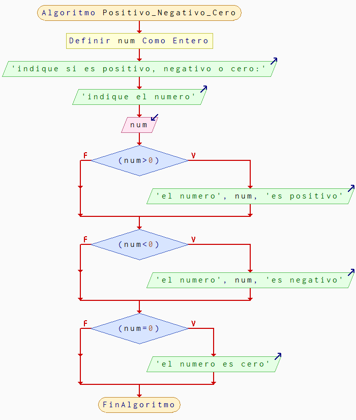

# Ejercicio 03: Positivo, Negativo o Cero

**Nivel:** Básico

## Enunciado
Positivo, Negativo o Cero: Leer un número entero y determinar si es positivo, negativo o cero. Mostrar un mensaje por cada caso.

## Pseudocódigo

```text
Algoritmo Positivo_Negativo_Cero
	Definir num Como Entero
	Escribir 'indique si es positivo, negativo o cero:'
	Escribir 'indique el numero'
	Leer num
	Si (num>0) Entonces
		Escribir 'el numero', num, 'es positivo'
	FinSi
	Si (num<0) Entonces
		Escribir 'el numero', num, 'es negativo'
	FinSi
	Si (num=0) Entonces
		Escribir 'el numero es cero'
	FinSi
FinAlgoritmo
```

## Diagrama de Flujo



---
[⬅ Volver al README](../../README.md)
