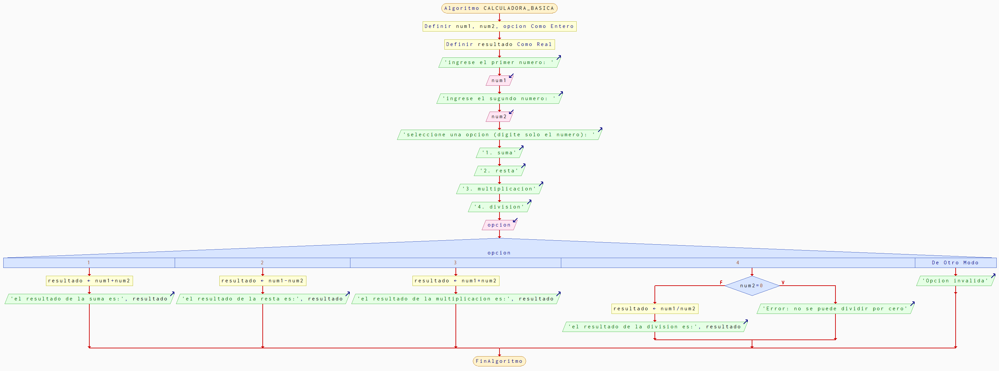

# Ejercicio 04: Calculadora Básica

**Nivel:** Básico

## Enunciado

Leer dos números enteros y una opción (1: Suma, 2: Resta, 3: Multiplicación, 4: División). Realizar la operación correspondiente y mostrar el resultado. Validar que no se divida por cero.


## Pseudocódigo

```text
Algoritmo CALCULADORA_BASICA
	Definir num1, num2, opcion Como Entero
	Definir resultado Como Real
	Escribir 'ingrese el primer numero: '
	Leer num1
	Escribir 'ingrese el sugundo numero: '
	Leer num2
	Escribir 'seleccione una opcion (digite solo el numero): '
	Escribir '1. suma'
	Escribir '2. resta'
	Escribir '3. multiplicacion'
	Escribir '4. division'
	Leer opcion
	Seg�n opcion Hacer
		1:
			resultado <- num1+num2
			Escribir 'el resultado de la suma es:', resultado
		2:
			resultado <- num1-num2
			Escribir 'el resultado de la resta es:', resultado
		3:
			resultado <- num1*num2
			Escribir 'el resultado de la multiplicacion es:', resultado
		4:
			Si num2=0 Entonces
				Escribir 'Error: no se puede dividir por cero'
			SiNo
				resultado <- num1/num2
				Escribir 'el resultado de la division es:', resultado
			FinSi
		De Otro Modo:
			Escribir 'Opcion invalida'
	FinSeg�n
FinAlgoritmo
```


## Diagrama de Flujo



---
[⬅ Volver al README](../../README.md)
