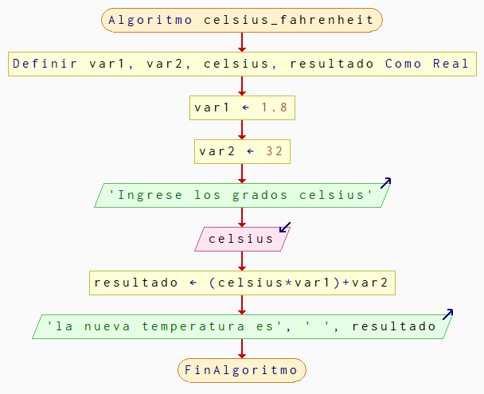

# Ejercicio 05: Conversión de Temperatura

**Nivel:** Básico

## Enunciado

Leer una temperatura en grados Celsius y convertirla a grados Fahrenheit. Mostrar el resultado.


## Pseudocódigo

```text
Algoritmo celsius_fahrenheit
	Definir var1, var2, celsius, resultado Como Real
	var1 <- 1.8
	var2 <- 32
	Escribir 'Ingrese los grados celsius'
	Leer celsius
	resultado <- (celsius*var1)+var2
	Escribir 'la nueva temperatura es', ' ', resultado
FinAlgoritmo
```

## Diagrama de Flujo



---
[⬅ Volver al README](../../README.md)
