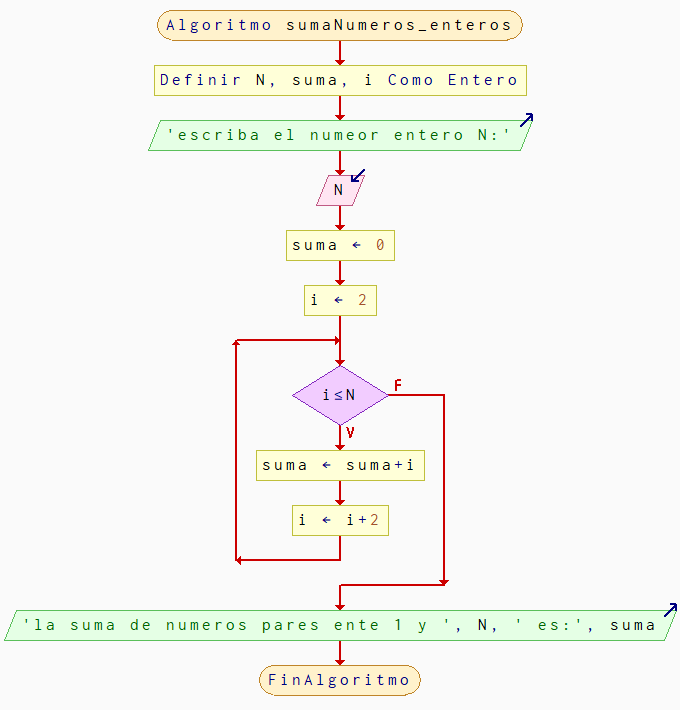

# Ejercicio 06: Suma de Números Pares

**Nivel:** Intermedio

## Enunciado

Leer un número entero N y calcular la suma de todos los números pares comprendidos entre 1 y N. Mostrar el resultado.

## Pseudocódigo

```text
#Algoritmo sumaNumeros_enteros
	Definir N, suma, i Como Entero
	
	Escribir "escriba el numeor entero N:"
	Leer N
	suma<-0
	i<-2
	Mientras i <= N Hacer
		suma<-suma+i
		i<-i+2
	Fin Mientras
	Escribir "la suma de numeros pares ente 1 y " , N, " es:", suma
FinAlgoritmo
```

## Diagrama de Flujo



---
[⬅ Volver al README](../../README.md)
