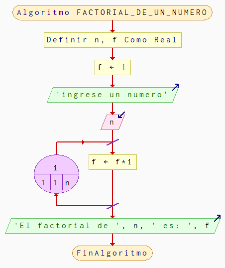

# Ejercicio 07: Factorial de un Número

**Nivel:** Intermedio

## Enunciado

Leer un número entero positivo y calcular su factorial (ej: 5! = 5×4×3×2×1 = 120). Mostrar el resultado.


## Pseudocódigo

```text
Algoritmo Factorial_de_un_Numero
	Definir n, f Como Real
	f<-1
	
	Escribir "ingrese un numero"
	Leer n
	
	Para i<-1 Hasta n Con Paso 1 Hacer
		f<-f*i
	FinPara
	Escribir "El factorial de ",n, " es: ", f 
FinAlgoritmo
```

## Diagrama de Flujo



---
[⬅ Volver al README](../../README.md)
