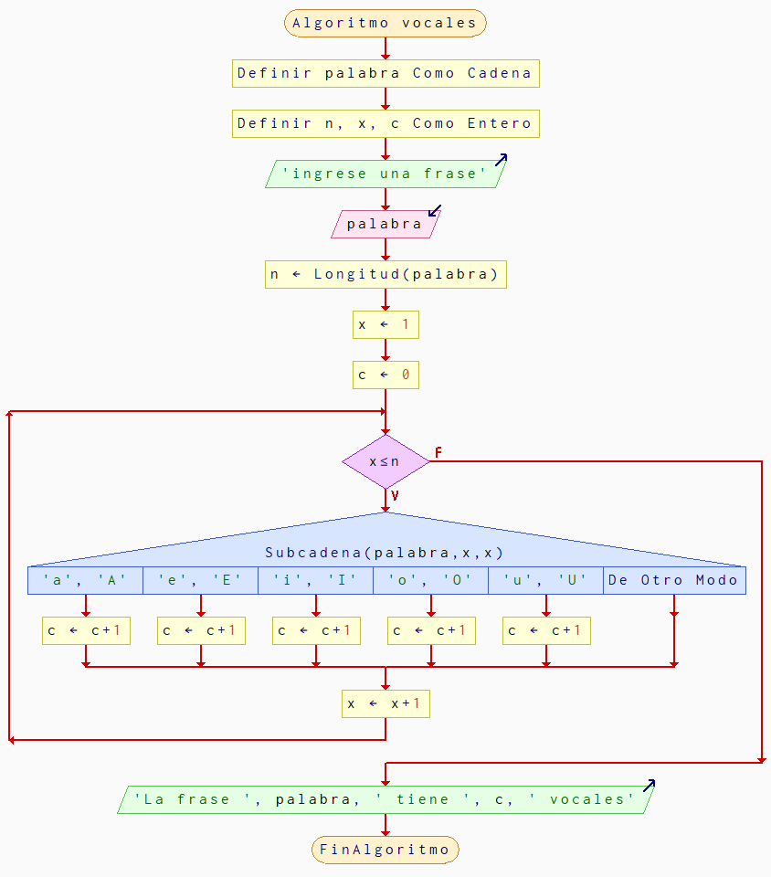

# Ejercicio 08: Contar Vocales en una Cadena

**Nivel:** Intermedio

## Enunciado

Leer una cadena de texto (palabra o frase corta) y contar cuántas vocales contiene. Mostrar el total.

## Análisis
en este pseudocodigo se puede ver un progama de conteo de vocales que contienen las frases, esta desarrollado por una funcion la cual es la de longitud para poder calcular la cantidad de caracteres de la frase, se le dio valor a las variables "x, c", se uso un bucle de mientras para poder hacer el conteo de vocales de la frase 


## Pseudocódigo

```text
Algoritmo vocales
	
	Definir palabra Como Caracter
	definir n, x, c Como Entero
	
	Escribir "ingrese una frase"
	Leer palabra
	
	n <- Longitud(palabra)
	x <- 1
	c <- 0
	Mientras x <= n Hacer
		Segun Subcadena(palabra,x,x) Hacer
			"a" o "A":
				c <- c + 1
			"e" o "E":
				c <- c + 1
			"i" o "I":
				c <- c + 1
			"o" o "O":
				c <- c + 1
			"u" o "U":
				c <- c + 1
		FinSegun
		x <- x + 1
	FinMientras

	Escribir "La frase ",palabra," tiene ",c," vocales"
	
FinAlgoritmo
```


## Diagrama de Flujo



---
[⬅ Volver al README](../../README.md)
