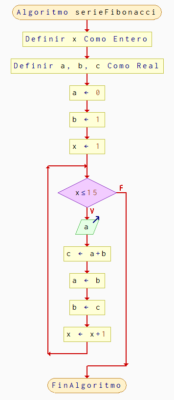

# Ejercicio 09: Serie de Fibonacci

**Nivel:** Intermedio

## Enunciado

Leer un número N y mostrar los primeros N términos de la serie de Fibonacci (0, 1, 1, 2, 3, 5, 8...).


## Pseudocódigo

```text
Algoritmo serieFibonacci
	Definir x Como Entero
	Definir a, b, c Como Real
	a<-0
	b<-1
	x<-1
	
	Mientras x <= 15 Hacer
		Escribir a
		c = a + b
		a = b
		b = c
		x = x + 1 
		
	FinMientras
	
FinAlgoritmo
```

## Diagrama de Flujo



---
[⬅ Volver al README](../../README.md)
