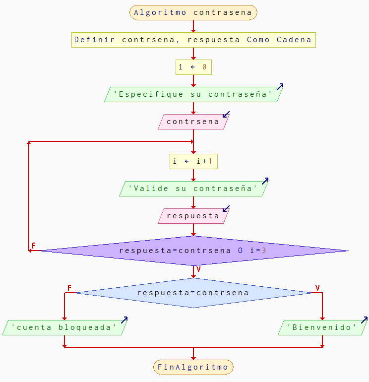

# Ejercicio 10: Validar Contraseña

**Nivel:** Intermedio

## Enunciado

Simular un sistema de login. El usuario tiene 3 intentos para ingresar la contraseña correcta ("12345"). Si acierta, mostrar "Bienvenido". Si falla los 3 intentos, mostrar "Cuenta bloqueada".


## Pseudocódigo

```text
Algoritmo contrasena
	Definir contrsena, respuesta Como Caracter
	i<-0

	Escribir "Especifique su contrasena"
	Leer contrsena
	
	Repetir
		i<-i+1
		Escribir "Valide su contrasena"
		Leer respuesta
	Hasta Que respuesta=contrsena o i=3
	si respuesta = contrsena Entonces
		Escribir "Bienvenido"
	SiNo
		Escribir "cuenta bloqueada"
	FinSi
	
FinAlgoritmo
```

## Diagrama de Flujo



---
[⬅ Volver al README](../../README.md)
